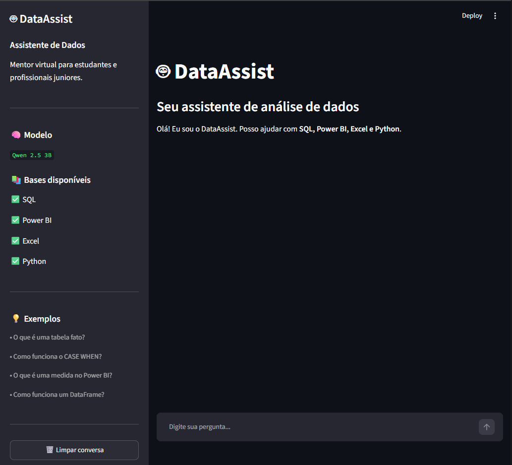

# 🤖 DataAssist

## Assistente virtual de Inteligência Artificial para estudantes e profissionais de Dados

O **DataAssist** é um assistente virtual desenvolvido em Python para auxiliar estudantes e profissionais juniores de Dados em dúvidas relacionadas a **SQL, Power BI, Excel e Python**.

A aplicação utiliza **Inteligência Artificial executada localmente**, por meio do Ollama e do modelo Qwen 2.5 3B, combinada com uma base de conhecimento própria e mecanismos de validação de escopo.

O objetivo é demonstrar, na prática, como construir uma aplicação de IA com **Python, interface conversacional, engenharia de prompts, base de conhecimento e controle das respostas geradas pelo modelo**.

---

## 🎯 Objetivo

O DataAssist foi desenvolvido com a proposta de funcionar como um **mentor virtual de análise de dados**, oferecendo explicações didáticas sobre conceitos utilizados no dia a dia de profissionais da área.

O projeto também busca explorar um problema comum em aplicações com modelos de linguagem:

> Como impedir que o modelo simplesmente invente ou complemente informações quando determinado assunto não faz parte da base de conhecimento?

Para isso, o DataAssist possui uma camada de validação implementada em Python antes da chamada ao modelo.

---

## 🖥️ Demonstração



## 💡 Principais funcionalidades

### 📚 Base de conhecimento

O projeto possui bases de conhecimento independentes para:

* SQL
* Power BI
* Excel
* Python

Cada assunto possui seu próprio arquivo Markdown dentro da pasta `data/`.

### 🔎 Identificação do assunto

Antes de consultar o modelo, o sistema identifica o assunto relacionado à pergunta.

Exemplo:

```text
Usuário
   ↓
"O que é uma tabela fato?"
   ↓
Identificação do assunto
   ↓
Power BI
   ↓
data/powerbi.md
   ↓
Qwen 2.5 3B
   ↓
Resposta
```

### 🛡️ Controle de escopo

O DataAssist possui uma camada de validação em Python para evitar que determinados assuntos sejam enviados ao modelo quando não estão disponíveis na base.

Por exemplo:

```text
"Qual é a diferença entre INNER JOIN e FULL OUTER JOIN?"
```

A base atual possui:

```text
INNER JOIN       ✅
LEFT JOIN        ✅
FULL OUTER JOIN  ❌
```

Nesse caso, o sistema identifica que `FULL OUTER JOIN` ainda não está documentado e interrompe o processamento antes de consultar o modelo.

Resultado:

```text
🤖 Essa informação não está disponível
na minha base de conhecimento.
```

Essa abordagem reduz a dependência exclusiva de prompts para controlar o comportamento do modelo.

### 💬 Interface conversacional

A interface foi desenvolvida utilizando Streamlit e possui:

* Histórico da conversa;
* Campo de perguntas;
* Indicador de processamento;
* Sidebar informativa;
* Modelo utilizado;
* Bases disponíveis;
* Exemplos de perguntas;
* Identificação da fonte utilizada;
* Botão para limpar a conversa.

---

## 🏗️ Arquitetura

O fluxo principal da aplicação é:

```text
┌──────────────────────┐
│       Usuário        │
│      pergunta        │
└──────────┬───────────┘
           │
           ▼
┌──────────────────────┐
│      Streamlit       │
│    Interface Web     │
└──────────┬───────────┘
           │
           ▼
┌──────────────────────┐
│ Identificação do     │
│ assunto               │
└──────────┬───────────┘
           │
           ▼
┌──────────────────────┐
│ Validação de escopo  │
└──────────┬───────────┘
           │
      ┌────┴─────┐
      │          │
   Suportado   Não suportado
      │          │
      ▼          ▼
┌───────────┐  ┌────────────────┐
│   Base de │  │ Mensagem de    │
│ conhecimento│ │ limitação      │
└─────┬─────┘  └────────────────┘
      │
      ▼
┌──────────────────────┐
│       Ollama         │
│     Qwen 2.5 3B      │
└──────────┬───────────┘
           │
           ▼
┌──────────────────────┐
│ Resposta baseada     │
│ no contexto enviado  │
└──────────────────────┘
```

---

## 📁 Estrutura do projeto

```text
assistente-virtual-ia/
│
├── data/
│   ├── excel.md
│   ├── powerbi.md
│   ├── python.md
│   └── sql.md
│
├── docs/
│   ├── 01-documentacao-agente.md
│   ├── 02-base-conhecimento.md
│   └── 03-prompts.md
│
├── src/
│   └── app.py
│
├── .gitignore
├── README.md
├── requirements.txt
└── teste_ollama.py
```

---

## 🛠️ Tecnologias utilizadas

| Tecnologia      | Utilização                                         |
| --------------- | -------------------------------------------------- |
| **Python**      | Desenvolvimento da aplicação e regras de validação |
| **Streamlit**   | Interface web conversacional                       |
| **Ollama**      | Execução local do modelo de linguagem              |
| **Qwen 2.5 3B** | Modelo de linguagem                                |
| **Markdown**    | Armazenamento da base de conhecimento              |

---

## 🤖 Inteligência Artificial

O DataAssist utiliza o modelo:

```text
qwen2.5:3b
```

O modelo é executado localmente através do **Ollama**.

Isso permite que a aplicação realize as inferências sem depender diretamente de uma API externa de IA.

A temperatura utilizada atualmente é:

```text
0.2
```

A configuração busca favorecer respostas mais consistentes e objetivas.

---

## 📚 Conteúdo da base de conhecimento

### SQL

Arquivo:

```text
data/sql.md
```

Conteúdos atuais:

* SELECT
* WHERE
* ORDER BY
* GROUP BY
* Funções de agregação
* CASE WHEN
* INNER JOIN
* LEFT JOIN
* DISTINCT
* NULL
* Boas práticas

### Exemplo: Power BI

Arquivo:

```text
data/powerbi.md
```

Conteúdos atuais:

* Tabela fato
* Tabela dimensão
* Relacionamentos
* Cardinalidade
* Modelo estrela
* Medidas
* DAX
* CALCULATE
* Power Query

### Excel

Arquivo:

```text
data/excel.md
```

Conteúdos atuais:

* SOMA
* MÉDIA
* CONTAGEM
* SE
* CONT.SE
* SOMASE
* PROCX
* PROCV
* XLOOKUP
* Tabelas dinâmicas
* Filtros

### Python

Arquivo:

```text
data/python.md
```

Conteúdos atuais:

* Variáveis
* Tipos de dados
* Condições
* Listas
* Loops
* Funções
* Pandas
* DataFrame
* Leitura de CSV

---

## 🚀 Como executar

### 1. Clonar o projeto

```bash
git clone https://github.com/oxmarneto/dataassist.git
cd dataassist
```

### 2. Criar o ambiente virtual

```bash
python -m venv .venv
```

No Windows PowerShell:

```powershell
.venv\Scripts\Activate.ps1
```

### 3. Instalar as dependências

```powershell
pip install -r requirements.txt
```

O arquivo `requirements.txt` contém:

```text
streamlit
ollama
```

### 4. Instalar o Ollama

Após instalar o Ollama, baixe o modelo utilizado pelo projeto:

```powershell
ollama pull qwen2.5:3b
```

Verifique se o modelo está disponível:

```powershell
ollama list
```

### 5. Executar o DataAssist

Na raiz do projeto:

```powershell
streamlit run src/app.py
```

A aplicação estará disponível normalmente em:

```text
http://localhost:8501
```

---

## 🧪 Exemplos de utilização

### 💡 Pergunta de exemplo — Power BI

```text
O que é uma tabela fato?
```

### 💡 Pergunta de exemplo — SQL

```text
Como funciona o CASE WHEN?
```

### 💡 Pergunta de exemplo — Excel

```text
Como funciona o PROCX?
```

### 💡 Pergunta de exemplo — Python

```text
O que é um DataFrame?
```

### Pergunta fora do escopo

```text
O que é inteligência artificial generativa?
```

Nesse caso, como o assunto não faz parte da base atual, o DataAssist informa que não possui conhecimento suficiente para responder.

---

## 🛡️ Estratégia de controle de respostas

Uma das características mais importantes do projeto é que o controle não depende exclusivamente do prompt enviado ao modelo.

O fluxo possui uma validação anterior à chamada do Ollama.

Por exemplo:

```text
Pergunta
   ↓
Identificação do assunto
   ↓
Verificação dos tópicos
   ↓
┌─────────────────────────┐
│ Tópico está disponível? │
└────────────┬────────────┘
             │
       ┌─────┴─────┐
       │           │
      SIM          NÃO
       │           │
       ▼           ▼
   Ollama       Bloqueio
       │           │
       ▼           ▼
   Resposta     Limitação
```

Essa camada permite que regras determinísticas em Python controlem situações que não devem chegar ao modelo.

---

## ⚠️ Limitações atuais

O DataAssist está em uma versão inicial e possui algumas limitações.

### Base de conhecimento limitada

O conteúdo disponível para o modelo está restrito aos arquivos Markdown existentes na pasta `data/`.

### Validação baseada em tópicos

A validação atual utiliza listas de tópicos e regras determinísticas. Ela ainda não possui busca semântica.

### Não é um RAG completo

Apesar de utilizar uma base de conhecimento para fornecer contexto ao modelo, a versão atual ainda não implementa uma arquitetura completa de **Retrieval-Augmented Generation (RAG)** com embeddings e busca vetorial.

### Expansão manual

A inclusão de novos assuntos exige atualmente alterações na base de conhecimento e nas regras de validação.

### Modelo local

O desempenho do Qwen 2.5 3B depende do hardware utilizado, principalmente em máquinas sem uma GPU adequada para inferência.

---

## 🔮 Próximas evoluções

Possíveis melhorias para futuras versões:

* Implementação de embeddings;
* Busca semântica;
* Implementação de RAG;
* Expansão das bases de conhecimento;
* Inclusão de novos assuntos;
* Melhor tratamento de perguntas com múltiplos conceitos;
* Avaliação automática das respostas;
* Registro de perguntas e respostas;
* Métricas de utilização;
* Interface mais avançada;
* Testes automatizados;
* Suporte a modelos maiores.

---

## 🎓 Aprendizados

O desenvolvimento do DataAssist permitiu praticar conceitos relacionados a:

* Python;
* Manipulação de arquivos;
* Expressões regulares;
* Streamlit;
* Modelos de linguagem;
* Ollama;
* Engenharia de prompts;
* Bases de conhecimento;
* Controle de contexto;
* Validação de entradas;
* Arquitetura de aplicações com IA;
* Desenvolvimento de aplicações orientadas a dados.

---

## 📌 Status do projeto

### MVP funcional

O DataAssist possui atualmente:

* ✅ Interface conversacional;
* ✅ IA local;
* ✅ Qwen 2.5 3B;
* ✅ Ollama;
* ✅ Base de conhecimento segmentada;
* ✅ Identificação de assuntos;
* ✅ Controle de escopo;
* ✅ Histórico da conversa;
* ✅ Interface com Streamlit;
* ✅ Documentação técnica.

---

## 👨‍💻 Projeto

### DataAssist — Assistente Virtual de Análise de Dados

Projeto desenvolvido como laboratório prático de Inteligência Artificial, adaptado para o contexto de **Análise de Dados e Business Intelligence**.

A aplicação foi construída com foco em aprendizado prático de integração entre **Python, IA generativa, bases de conhecimento e aplicações de dados**.
